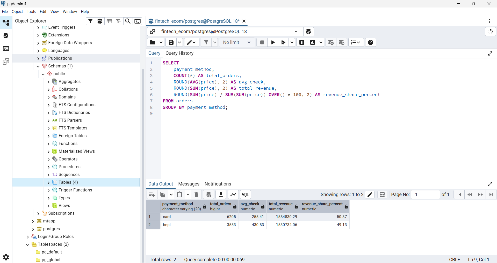
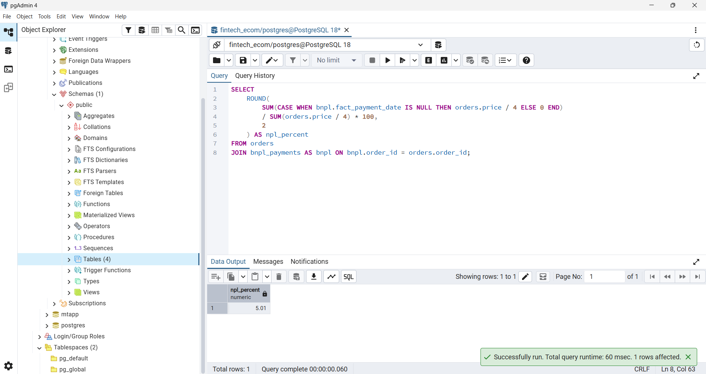

# 📈 Анализ эффективности и рисков BNPL-сервиса в eCommerce (Продуктовая + Финтех Аналитика)

## 📌 Описание бизнес-кейса
В данном проекте я исследовал внедрение финтех-инструмента «Оплата частями» (BNPL) на маркетплейсе.

**Цель проекта:** Доказать бизнесу эффективность BNPL-механики (оценить рост среднего чека, объемы продаж) и рассчитать маркеры финансового риска кредитного портфеля (метрику NPL для риск-команды). Дополнительно была проведена проверка продуктовой гипотезы (A/B-тест) о влиянии лимита на выдачу BNPL.

*Кейс симулирует реальные задачи продуктового аналитика в таких экосистемах, как Т-Банк (Долями), Яндекс (Сплит) или Ozon Банк.*

## 🛠 Стек технологий
* **СУБД:** PostgreSQL / pgAdmin 4
* **Продвинутый SQL:** Оконные функции (`OVER`), Условная агрегация (`CASE WHEN`), Сложные `JOIN`, Оптимизация структуры (нормализация данных).
* **Python:** `Pandas` (инженерия данных, фильтрация сырого Big Data 10 ГБ+), `SciPy` (статистика, Хи-квадрат), `Seaborn/Matplotlib` (визуализация).
* **Источник данных:** Открытый датасет Kaggle: [eCommerce behavior data from multi-category store (October 2019)](https://www.kaggle.com/datasets/mkechinov/ecommerce-behavior-data-from-multi-category-store).

## 📐 Архитектура проекта и Инженерия данных
Исходный плоский файл объемом 10 ГБ+ содержал 67 млн строк. В рамках демонстрации инженерных навыков:
1. Сырой лог был профильтрован скриптом на Python (пакетный метод `chunksize`).
2. База данных была нормализована. Данные распределены из временной таблицы по 3 боевым сущностям: `users`, `orders`, `bnpl_payments` с простановкой внешних ключей (`REFERENCES`).

---

## 📊 Ключевые результаты и Бизнес-инсайты

### 1. Как BNPL влияет на средний чек (AOV) и продажи (SQL)
С помощью оконных функций был проведен анализ структуры продаж интернет-магазина.

**SQL-запрос:**
```sql
SELECT 
    payment_method, 
    COUNT(*) AS total_orders, 
    ROUND(AVG(price), 2) AS avg_check, 
    ROUND(SUM(price), 2) AS total_revenue, 
    ROUND(SUM(price) / SUM(SUM(price)) OVER() * 100, 2) AS revenue_share_percent
FROM orders 
GROUP BY payment_method;
```

**Результаты:**
* Обычная оплата картой: 6 205 заказов, средний чек — 255.41 у.е.
* Оплата частями (BNPL): 3 553 заказа, средний чек — 430.83 у.е.

💡 **Бизнес-вывод:** Внедрение BNPL увеличило средний чек в 1.7 раза. Данный финтех-инструмент эффективно снимает психологический барьер стоимости товара. В результате BNPL сгенерировал 49.13% всей выручки, хотя количество заказов в этой группе почти в 2 раза меньше, чем по картам.


### 2. Оценка рисков кредитного портфеля (Метрика NPL) (SQL)
Для оценки здоровья финтех-продукта была рассчитана метрика NPL (Non-Performing Loans) — доля просроченных платежей от общего官方 объема выданных рассрочек. Был написан запрос с условной агрегацией.

**SQL-запрос:**
```sql
SELECT 
    ROUND(
        SUM(CASE WHEN bnpl.fact_payment_date IS NULL THEN orders.price / 4 ELSE 0 END) / 
        SUM(orders.price / 4) * 100, 2
    ) AS npl_percent
FROM orders 
JOIN bnpl_payments AS bnpl ON bnpl.order_id = orders.order_id;
```

**Результаты:**
* Выявлено 711 просроченных долей платежей.
* Финальный показатель NPL = 5.01%.

💡 **Бизнес-вывод:** Текущий уровень NPL (5.01%) находится в умеренно-рискованной, но допустимой зоне для старта продукта. Команде риск-менеджмента рекомендуется оптимизировать скоринг-модели для удержания NPL в пределах целевых <4% на следующем этапе масштабирования.



### 3. Сегментация BNPL-заказов по сумме чека (Python)
С помощью Python (Pandas) я разбил BNPL-заказы на группы (до 500 у.е. и выше 500 у.е.), чтобы понять, как распределяются выручка и количество транзакций.

💡 **Бизнес-вывод:** Основную выручку (более 60%) приносят заказы дороже 500 у.е., однако их количество в два раза меньше, чем заказов среднего ценового сегмента. Это подтверждает, что BNPL чаще используют для дорогих покупок.

https://images/segmentation.png

### 4. 🧪 Симуляция A/B-теста (Ограничение BNPL для крупных чеков)
Проверка гипотезы: *«Если ограничить выдачу BNPL для заказов дороже 500 у.е., уровень просрочки (NPL) снизится»*.

* **Control** (Текущая ситуация): Все заказы. Выручка: ~1 530 734 у.е., NPL: 5.00%.
* **Test** (Лимит 500): Только заказы до 500 у.е. Выручка: ~596 483 у.е., NPL: 5.07%.

С помощью критерия Хи-квадрат Пирсона (`scipy.stats`) было установлено, что ограничение лимита не приводит к статистически значимому снижению уровня просрочки (разница в NPL составила всего 0.07%, p-value = 0.823).

💡 **Бизнес-вывод:** Размер чека не является ключевым фактором риска дефолта в данной выборке. Введение жесткого лимита приведет к потере 61% выручки без ощутимого снижения кредитного риска. Рекомендуется внедрение более сложной системы скоринга (например, на основе истории пользователя), а не просто отсечение крупных сумм.

https://images/ab_test.png

## 🗺 Как запустить проект локально
1. Скачать сырой датасет с Kaggle (ссылка выше).
2. Установить зависимости: `pip install -r requirements.txt`.
3. Выполнить SQL-скрипты из папки `sql_scripts` в pgAdmin 4 для воспроизведения метрик AOV и NPL.
4. Запустить Jupyter-ноутбуки из папки `notebooks` для просмотра логики сегментации и A/B-теста.
